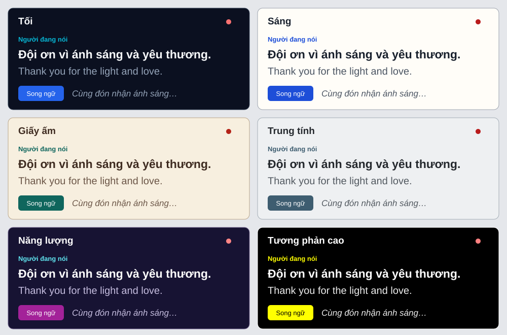

# Sáu giao diện phụ đề — nghiệm thu 28/10/2026

Base `dc08046`, branch `feature/caption-themes`. Chỉ frontend; không sửa Edge Function, migration hoặc dữ liệu production.

## Hành vi

- Tối mặc định, giữ nền `#0B1020` và bốn token caption cũ. Thêm Sáng, Giấy ấm, Trung tính, Năng lượng, Tương phản cao.
- Màu trang/header/nút/viền/nút đang chọn/loading/partial/jump dùng token caption. Scope `data-caption-theme` tại gốc trang, popup portal và từng ô xem trước; không đổi giao diện toàn FUN Profile.
- Popup cạnh ngôn ngữ/cỡ chữ, có đủ sáu ô nền + hai dòng mẫu + tên và check/aria-pressed. Accessible name của trigger chứa lựa chọn hiện tại.
- Chọn đổi tức thì qua React state, lưu `caption-theme` theo thiết bị. Giá trị thiếu/sai hoặc storage lỗi về Tối; storage bị chặn vẫn đổi được trong trang hiện tại.
- Cỡ chữ 18–48, mode VI/EN/song ngữ, native scroll, panel sáu dòng, partial và realtime/polling giữ nguyên đường dữ liệu. Tên người nói trong partial dùng màu speaker; phần chữ đang nhận dùng muted.

## Kiểm tra trình duyệt

Dùng chính `CaptionsPage` với fixture backend local, không đăng nhập và không tạo dữ liệu production. Fixture có câu gốc/câu dịch/tên người nói/partial và thêm dòng định kỳ để kiểm tra cuộn. Đây là nghiệm thu UI trên dữ liệu mẫu, không phải phép thử STT/dịch live.

| Tiêu chí | Kết quả |
| --- | --- |
| Kiểm tra bằng mắt toàn trang ở sáu giao diện | Đạt; đã chụp/xem trong phiên kiểm tra |
| Sáng/Giấy ấm/Trung tính | Chữ gốc và dịch đậm trên nền sáng; tên royal/teal/xám xanh |
| Năng lượng | Nền chàm phẳng, chữ trắng, speaker cyan, nút chọn magenta |
| Tương phản cao | Nền RGB 0,0,0; chữ trắng; tên vàng; viền nút trắng |
| Chọn tức thì, không reload | Đạt, đổi ngay nền/partial/nút và dấu chọn |
| Reload giữ lựa chọn | `high-contrast` vẫn được chọn |
| Mở tab/mã phiên khác | Vẫn `high-contrast` trên cùng localhost/thiết bị |
| Xóa preference qua UI thử rồi mở lại | `dark` |
| −/+ ở từng giao diện | 28 → 32 → 28px, đủ sáu giao diện |
| Giới hạn cỡ chữ | Giảm nhiều lần chặn 18px; tăng nhiều lần chặn 48px |
| 320×568, đủ sáu giao diện ở 48px | Không tràn ngang; header cao 137.56px ở mọi lựa chọn |
| Popup ở 320px | Đủ sáu lựa chọn, nằm trong viewport, có thể cuộn |
| Cuộn lên khi có dòng mới | Hiện số dòng mới; click đưa về đáy, lệch 1px do làm tròn |

Ở 320×568/cỡ 28, lịch sử còn 199.44px. Ở cỡ 48, panel sáu dòng giữ 396px nên lịch sử chỉ còn 34.44px; đây là hệ quả của yêu cầu giữ panel/cỡ chữ, không đổi chiều cao panel trong tính năng giao diện. Nhóm −/+ không tách thành hai hàng; trigger giới hạn rộng theo breakpoint.

Ảnh trình duyệt đã xem qua công cụ, chưa xuất thành file ảnh độc lập. Bảng dưới là bản xem trước tạo trực tiếp từ token, **không phải ảnh chụp màn hình**:

## Kiểm tra tự động và review

- `bun test src`: **70 đạt, 0 lỗi**. Gồm storage thiếu/sai/bị chặn; đổi cả sáu theme giữ mode/font/scroll/unread; hồi quy partial/poll/reconnect/memo history; kiểm tra tương phản màu thực tế từ CSS.
- Các cặp chữ/nền chính, phụ, speaker, live và control/selected đạt ít nhất **4.5:1**. [Số đo](./caption-themes-contrast.json) ghi riêng các cặp trên nền trang và nút chọn; test còn kiểm tra chữ trên control/hover.
- Build Vite/PWA đạt; có cảnh báo kích thước chunk sẵn có và dữ liệu baseline-browser-mapping cũ. Không nâng dependency ngoài phạm vi.
- `bunx tsc --noEmit -p tsconfig.app.json` đạt. ESLint các file sản phẩm sửa/thêm đạt. `git diff --check` đạt.
- Bare `bun test` vẫn có **70 lỗi** khi Bun tải bộ test Edge/Deno (npm specifier/Deno globals), như trước; không báo toàn repo xanh. Đợt này không chạy `deno test` vì không sửa Edge Function.
- Review độc lập không xác nhận lỗi chặn. Đã đo thực tế nghi vấn collapse trên màn hình hẹp; history vẫn có chiều cao. Đã bổ sung tên lựa chọn cho accessible name và ổn định nhóm nút.

Fixture local được dọn trước commit. Bé đã yêu cầu merge vào `main` sau nghiệm thu; không thực hiện deploy production thủ công trong đợt này.
